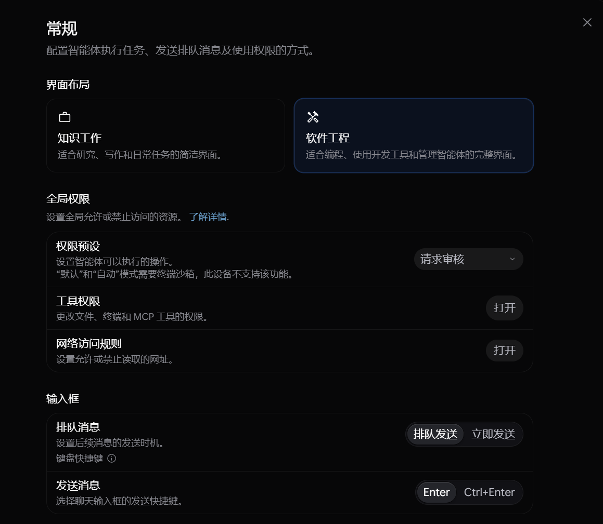

# Antigravity 中文界面补丁（Windows）

为 **Google Antigravity 桌面版 2.35.2 · Windows x64** 提供非官方简体中文界面。补丁版本为 **2.3.0**。用于更新后的 2.35.2 原版客户端。安装后从原来的快捷方式启动即可。



## 下载和安装

1. 取得 **antigravity-zh-windows-v2.3.0.zip** 后，右键选择「全部解压」。
2. 准备 Python 3.8 或更高版本，双击解压目录里的 **汉化工具.cmd**，选 **1** 检查兼容性。启动器支持 Windows 的 `py -3` 或 `python`。补丁使用 Python 标准库，安装过程在本机完成。[Python 官方下载](https://www.python.org/downloads/windows/)
3. 保存工作并完全退出 Antigravity，包括系统托盘中的程序。再次运行工具，选 **2** 安装，然后重新打开 Antigravity。
4. 看侧栏的「新建对话」「项目」「设置」。打开「设置 → 常规」，可以看到「工具权限」「网络访问规则」和「排队发送」。

## 汉化范围

| 界面 | 已覆盖的内容 |
| --- | --- |
| 主窗口 | 顶栏及其下拉菜单、侧栏对话操作与 Windows 原生右键菜单、首页推荐语、运行位置、本机权限和插件入口 |
| 设置 | 常规、布局、权限说明、外观、快捷键、模型配额、浏览器和部分对话配置 |
| 自动化 | 列表和空状态、新建任务、名称和说明输入提示、运行位置、触发条件与计划 |
| 自定义 | 市场和已安装页、搜索与分类、已安装扩展分组及空状态 |
| 项目与侧栏 | 项目选择器入口、新建项目的文件夹与工作区控件、分组、筛选和排序 |
| 模型与审阅 | 模型选择器中的思考强度和选项、编排器标签、文件变更计数与审阅按钮 |
| 语音设置 | 听写语言、自动识别、录音保存与删除提示 |
| 桌面控件 | 部分窗口菜单、托盘、工作区、更新、设备选择和 SSH 对话框 |

此工具翻译界面控件。会话正文、项目名称、模型名称和键盘按键沿用原文。部分插件、远程窗口和未收录的词条仍可能显示英文。AI 默认回复语言可以单独通过 Antigravity 的全局规则设置。[官方规则说明](https://antigravity.google/docs/rules/)

## 还原和版本更新

完全退出客户端，运行 **汉化工具.cmd** 并选 **3**。安装器用已验证的原版备份还原。备份保存在安装目录的 `resources/app.asar.original-2.35.2-zh-backup`，请保留。若备份已损坏或丢失，使用 Google 官方安装程序恢复。

兼容检查使用整个原版资源文件的 SHA-256。客户端更新后请先选 **1** 重新检查。若提示版本或文件不匹配，请等待适配版本。默认支持当前 Windows 用户的标准安装位置；自定义位置可在解压目录打开终端，执行如下命令，将示例目录替换为包含 `Antigravity.exe` 的文件夹。

```powershell
py -3 -I -B -X utf8 localize.py check --app-dir "E:\Apps\Antigravity"
```

确认可用后，将 `check` 改为 `install` 安装，或改为 `restore` 还原。

## 校验与实现

在 ZIP 所在目录打开 PowerShell，运行以下命令，并和随包提供的 **SHA256SUMS.txt** 核对。校验值用于确认下载文件的一致性。

```powershell
Get-FileHash -Algorithm SHA256 .\antigravity-zh-windows-v2.3.0.zip
```

- `localize.py` 核验原包、保留原版备份并写入验证过的资源包。
- `native-patch.json` 记录原生菜单文案在指定版本资源中的字节位置和替换文字。
- `ui-zh.tsv` 包含主界面英中对照。每行一组，列之间用制表符分隔。
- `interface.js` 在本机主窗口的预加载环境中翻译匹配的控件。界面更新时会再次匹配词表。

| 资源文件状态 | SHA-256 |
| --- | --- |
| 官方 2.35.2 原版 `app.asar`（已验证的构建） | `e057115571cf5085406d20f2427a5afac272b712ec84332c7157da0113d4b2d0` |
| 本版补丁安装后 | `67de159b1f3b1dc57976820b2850bf8ee2602dc727b752177099e8b207f011e5` |

## 反馈漏译

请在 Issues 中写明 **Antigravity 版本、补丁版本、菜单路径、英文原文**。例如「2.35.2 / 2.3.0 / 设置 → 常规 / 某个英文按钮」。如果附图，截取对应控件即可，请遮住邮箱、路径和对话内容。

## 来源和授权

本项目独立维护，借鉴了青鸟项目通过 GitHub Releases 分发、一键还原和提供 SHA-256 的做法。参考项目的代码和素材遵循该项目自身的授权。[参考项目](https://github.com/QingniaoDawn/Antigravity-YiJianHanHua)

本工具会修改本机安装的客户端，尚未取得 Google 对此补丁的认可或授权。Google Antigravity、相关商标和原始界面内容的权利归相应权利人。发布包仅提供本地补丁；使用前请查阅适用条款。[Antigravity 附加条款](https://antigravity.google/terms) · [Google 服务条款](https://policies.google.com/terms?hl=zh-CN)

本项目原创部分的使用和分发条件见 [LICENSE](LICENSE)。
